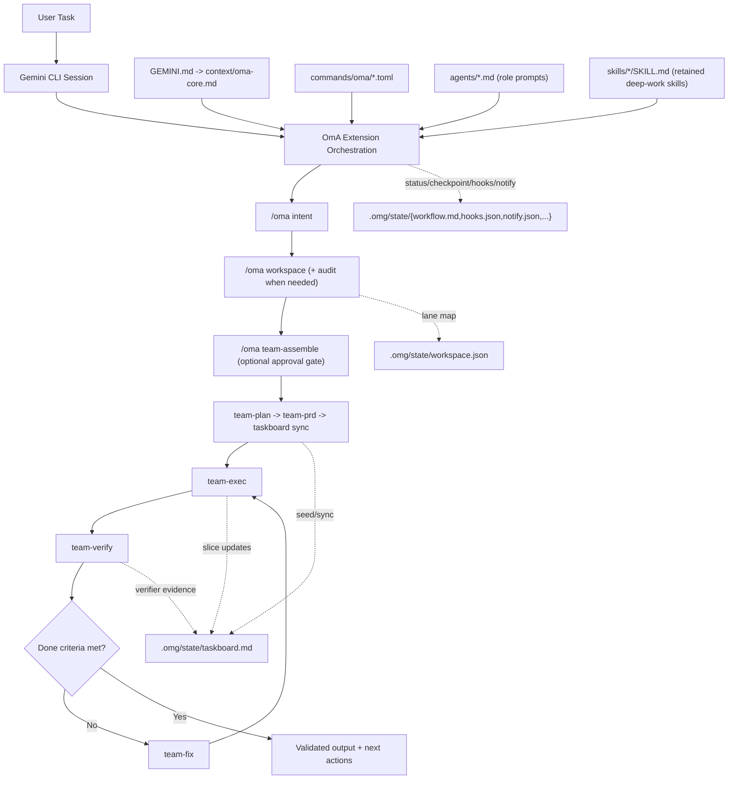
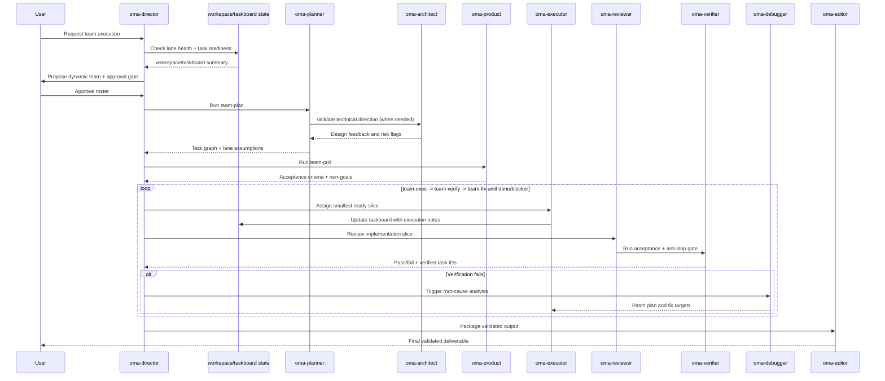

# oh-my-antigravity (OmA)

[](https://github.com/Joonghyun-Lee-Frieren/oh-my-antigravity/releases)
[](https://github.com/Joonghyun-Lee-Frieren/oh-my-antigravity/actions/workflows/version-check.yml)
[](../LICENSE)
[](https://github.com/Joonghyun-Lee-Frieren/oh-my-antigravity/stargazers)
[](https://geminicli.com/extensions/?name=Joonghyun-Lee-Frierenoh-my-antigravity)
[](https://github.com/sponsors/Joonghyun-Lee-Frieren)

[Página principal](https://joonghyun-lee-frieren.github.io/oh-my-antigravity/) | [Historial](./history.md)

[한국어](./README_ko.md) | [日本語](./README_ja.md) | [Français](./README_fr.md) | [中文](./README_zh.md) | [Español](./README_es.md)

Paquete de flujo de trabajo multiagente para Gemini CLI, impulsado por ingeniería de contexto.

> "La ventaja competitiva real de Claude Code no es Opus ni Sonnet. Es Claude Code en sí. Sorprendentemente, Gemini también funciona muy bien cuando se conecta al mismo harness."
>
> - Jeongkyu Shin (CEO de Lablup Inc.), en una entrevista de YouTube

Este proyecto empezó con esa observación:
"¿Qué pasa si llevamos ese modelo de harness a Gemini CLI?"

OmA amplía Gemini CLI desde un asistente de sesión única hacia un flujo de ingeniería estructurado y orientado por roles.

<p align="center">
  
</p>

## Soporte nativo de Antigravity · v0.10.0

Antigravity CLI es el entorno principal; Gemini CLI conserva una entrada de compatibilidad separada. Usa `/oma <command>` en modo nativo y `/oma:<command>` con Gemini. La política predeterminada `auto` conserva el modelo del entorno. `balanced` recomienda Flash para todas las tareas; `quality` recomienda Argon para planificación y revisión, y Flash para implementación. Los perfiles nativos no reemplazan `/model`. Comprueba el acceso de tu cuenta en el selector de modelos.

```bash
agy plugin install https://github.com/Joonghyun-Lee-Frieren/oh-my-antigravity
agy plugin list --json
```

```text
/oma status
/oma model auto
/oma goal implement the approved change and verify acceptance criteria
```

```bash
agy --model gemini-3.8-flash --effort medium
agy --model gemini-4-argon --effort high
```

Gemini CLI:

```bash
gemini extensions install https://github.com/Joonghyun-Lee-Frieren/oh-my-antigravity
```

```text
/oma:status
/oma:model auto
```

Node.js 22+ · Antigravity CLI 1.3.5 · 2026-10-15

[Installation](guide/installation.md) · [Models](guide/models.md) · [Hooks](guide/hook-engineering.md)

## v0.10.0

Antigravity CLI es el entorno principal; Gemini CLI conserva una entrada de compatibilidad separada. Usa `/oma <command>` en modo nativo y `/oma:<command>` con Gemini. La política predeterminada `auto` conserva el modelo del entorno. `balanced` recomienda Flash para todas las tareas; `quality` recomienda Argon para planificación y revisión, y Flash para implementación. Los perfiles nativos no reemplazan `/model`. Comprueba el acceso de tu cuenta en el selector de modelos.

Los hooks nativos observan los resultados y añaden un aviso limitado tras una denegación o fallos repetidos, sin forzar la continuación después de detenerse. Terminar una herramienta no equivale a superar una prueba. El evento oficial es `PostToolUse`, no `PostToolCalling`. Gemini usa un adaptador `AfterTool` separado y mantiene el filtro `AfterAgent`.

## Límite de extensión y seguridad de actualización

- Instala y actualiza OmA con `gemini extensions ...`; no dependas de carpetas copiadas de comandos/skills como ruta principal de runtime.
- Mantén una sola ruta autoritativa de registro de hooks OmA por evento. Mezclar hooks gestionados por extensión con duplicados manuales provoca salidas AfterAgent repetidas o comportamiento obsoleto.
- Si OmA parece desactualizado tras una actualización, revisa primero `agy plugin list --json`; luego refresca o reinstala la extensión antes de editar archivos distribuidos.
- Para trabajos largos o con múltiples lanes, trata `/oma workspace audit` como preflight por defecto antes de review, automatización o `team-exec`.

## Almacenamiento de sesiones de entrevista

- El estado de sesión de `/oma interview` ahora está pensado para vivir bajo `.omg/state/interviews/[slug]/` en vez de un único archivo compartido.
- `.omg/state/interviews/active.json` rastrea la entrevista actual para que resume/status sean deterministas sin mezclar hilos de requisitos.
- Esto mantiene distinguibles y archivables varias pasadas de descubrimiento de requisitos en el mismo proyecto.

## Estado compartido de workflow

- `.omg/state/session-lock.json` es ahora el bloqueo single-writer para el estado compartido de workflow y perfil operativo dentro de un proyecto.
- Solo la sesión de orquestación dueña del lock debe escribir archivos compartidos como `workspace.json`, `taskboard.md`, `workflow.md`, `checkpoint.md`, `mode.json`, `hud.json`, `approval.json`, `reasoning.json`, `hooks.json` y `notify.json`.
- Las sesiones top-level paralelas sin el lock deben escribir borradores locales en `.omg/state/sessions/[session-slug]/` y devolver esas notas al orquestador para merge.
- Los turnos delegados de worker/sub-agent deben ser mayormente de lectura y no mutar directamente el estado compartido.

## Resumen

| Elemento | Resumen |
| --- | --- |
| Modelo de entrega | Extensión oficial de Gemini CLI (`gemini-extension.json`) |
| Bloques principales | `GEMINI.md`, `agents/`, `commands/`, `skills/`, `context/` |
| Caso de uso principal | Tareas complejas que requieren bucles planificar -> ejecutar -> revisar |
| Superficie de control | Plano de control slash-command-first `/oma *` + 8 `$skills` de deep-work (incluye alias `oma-plan`) + delegación a sub-agentes |
| Estrategia de modelo por defecto | `auto` → host; `balanced` → Flash; `quality` → Argon / Flash |

## Por qué OmA

| Problema en flujo crudo de sesión única | Respuesta de OmA |
| --- | --- |
| El contexto se mezcla entre planificación y ejecución | Agentes separados por rol con responsabilidades enfocadas |
| Difícil mantener visibilidad del progreso en tareas largas | Etapas explícitas y comprobaciones por comando |
| Carriles paralelos o worktrees se desalinean | `workspace` + `taskboard` mantienen ownership de lane, IDs de tarea y estado de verificación en forma compacta y explícita |
| Llamadas de herramienta denegadas entran en bucles sin recuperación | Las acciones denegadas se convierten en eventos explícitos de aprobación/fallback con seguimiento de blockers |
| Entrevistas profundas se interrumpen con nudges automáticos | El hook de learn-signal suprime nudges con deep-interview lock activo y solo reanuda tras liberar el lock |
| Prompt engineering repetitivo para trabajos comunes | Comandos slash para control operativo + retained skills de deep-work (`$plan`, `$oma-plan`, `$execute`, `$research`) |
| Deriva entre "lo decidido" y "lo cambiado" | Roles de review y debugging dentro del mismo bucle de orquestación |

## Arquitectura



## Flujo de trabajo del equipo



## Ensamblaje dinámico de equipo

Usa `team-assemble` cuando un roster fijo de ingeniería no sea suficiente.

- Divide la selección en:
  - especialistas de dominio (expertise del problema)
  - especialistas de formato (calidad de reporte/contenido/salida)
- Lanza carriles de exploración en paralelo (`oma-researcher` xN) para descubrimiento amplio.
- Enruta decisiones por un carril de juicio (`oma-consultant` o `oma-architect`).
- Asigna esfuerzo de razonamiento por carril usando perfil global + overrides por teammate.
- Mantén explícitos los bucles verify/fix (`oma-reviewer` -> `oma-verifier` -> `oma-debugger`).
- Ejecuta verificación anti-slop antes de la entrega final.
- Exige aprobación explícita antes de iniciar ejecución autónoma.

Flujo de ejemplo:

```text
/oma team-assemble "Compara 3 competidores y genera un informe ejecutivo"
-> propone: researcher x3 + consultant + editor + director
-> pregunta: ¿Proceed with this team? (yes/no)
-> tras aprobar: team-plan -> team-prd -> taskboard -> team-exec -> team-verify -> team-fix
```

Nota de activación:
- OmA no requiere una configuración separada de research-preview.
- Si la extensión está cargada, `/oma team-assemble` queda disponible de inmediato.

## Control de Workspace y Taskboard

Usa `workspace` y `taskboard` cuando el trabajo abarque múltiples raíces, múltiples lanes de implementación o ciclos largos de verify/fix.

- `/oma workspace` mantiene la raíz principal y lanes opcionales worktree/path en `.omg/state/workspace.json`.
- `/oma workspace audit` revisa limpieza de lanes, estado de confianza y preparación de handoff antes de ejecución paralela, review o automatización.
- `/oma taskboard` mantiene IDs estables, owners, dependencias, estados (`todo`, `ready`, `in-progress`, `blocked`, `done`, `verified`), notas de salud de lane y punteros de evidencia en `.omg/state/taskboard.md`.
- `team-plan` siembra IDs estables y supuestos por lane, `team-exec` toma el slice listo más pequeño con contexto explícito de lane/subagent, y `team-verify` solo marca tareas como verificadas cuando hay evidencia y estado de lane seguro.
- `checkpoint` y `status` pueden referenciar estos archivos en lugar de re-reproducir todo el chat, mejorando estabilidad de caché y reduciendo gasto de tokens.
- `/oma recall "<consulta>"` hace recuperación state-first y búsqueda de fallback acotada para recuperar razonamiento previo sin re-reproducir transcripciones completas.

Flujo de ejemplo:

```text
/oma workspace set .
/oma workspace audit
/oma workspace add ../feature-auth oma-executor
/oma taskboard sync
/oma taskboard next
/oma recall "why was auth lane blocked" scope=state
```

## Higiene de Workspace y simetría de Hooks

Usa estos controles cuando las sesiones largas empiezan a desviarse porque ya no está clara la propiedad de lanes, la ejecución delegada o el comportamiento de continuación de hooks.

- `/oma workspace audit` muestra worktrees compartidos sucios, rutas de review no confiables y lanes handoff-ready vs handoff-blocked.
- `/oma hooks` y `/oma hooks-validate` ahora modelan resultados emparejados del ciclo de vida de agentes (`completed`, `blocked`, `stopped`) para que continuaciones bloqueadas reingresen una vez al safety lane antes de reanudar hooks downstream.
- `team-exec`, `team`, `team-verify`, `stop` y `cancel` mantienen compacto y explícito el contexto lane/subagent delegado, expandiendo detalle solo cuando la ejecución se detiene temprano o encuentra un blocker.

## Enrutamiento de notificaciones

Usa `notify` cuando una sesión OmA de larga duración necesita señales explícitas para aprobaciones, resultados de verificación, blockers o deriva por inactividad.

- Perfiles soportados:
  - `quiet`: solo interrupciones urgentes (`approval-needed`, `verify-failed`, `blocker-raised`, `session-stop`)
  - `balanced`: quiet + actualizaciones de checkpoint y team-approval
  - `watchdog`: balanced + alertas idle-watchdog para bucles desatendidos
- Canales soportados:
  - `desktop` (adaptador de notificación del host)
  - `terminal-bell`
  - `file`
  - `webhook` (bridge externo)
- Límite de seguridad:
  - OmA gestiona enrutamiento de eventos, plantillas y política persistida
  - la entrega real debe implementarse por hooks del host Gemini, adaptadores de shell o bridges webhook específicos del proyecto
  - las sesiones worker delegadas mantienen deshabilitado el dispatch externo salvo opt-in explícito del usuario

Flujo de ejemplo:

```text
/oma notify profile watchdog
-> enables: approval-needed, verify-failed, blocker-raised, checkpoint-saved, idle-watchdog, session-stop
-> sugiere canales: terminal-bell + file por defecto
-> persiste política: .omg/state/notify.json
```

## Lifecycle Hooks

Los hooks nativos observan los resultados y añaden un aviso limitado tras una denegación o fallos repetidos, sin forzar la continuación después de detenerse. Terminar una herramienta no equivale a superar una prueba. El evento oficial es `PostToolUse`, no `PostToolCalling`. Gemini usa un adaptador `AfterTool` separado y mantiene el filtro `AfterAgent`.

`PostToolUse` → `PreInvocation` → `Stop`

`OMG_TOOL_CYCLE=off` · `OMG_MODEL_ROUTING_TRACE=1`

`.omg/state/sessions/hooks-<session-key>/model-router-last.json`

## Model Policy

Antigravity CLI es el entorno principal; Gemini CLI conserva una entrada de compatibilidad separada. Usa `/oma <command>` en modo nativo y `/oma:<command>` con Gemini. La política predeterminada `auto` conserva el modelo del entorno. `balanced` recomienda Flash para todas las tareas; `quality` recomienda Argon para planificación y revisión, y Flash para implementación. Los perfiles nativos no reemplazan `/model`. Comprueba el acceso de tu cuenta en el selector de modelos.

## Filtro de seguridad Learn-Signal (AfterAgent Hook)

OmA también incluye un hook de learn-signal endurecido para seguridad, de modo que los nudges de `/oma learn` solo aparezcan cuando una sesión tiene intención de implementación accionable.

- Hook entrypoint: `hooks/hooks.json` (`AfterAgent` -> `oma-learn-signal-after-agent`)
- Script: `hooks/scripts/learn.js`
- Artefacto de estado: `.omg/state/learn-watch.json` (clave de evento deduplicada, seguimiento de sesión para prompt-once y estado saneado)
- Fuente de deep-interview lock (solo lectura): `.omg/state/deep-interview.json`
- Controles de runtime:
  - `OMG_STATE_ROOT=<dir>` para mover `learn-watch.json` junto al resto del estado OmA
  - `OMG_HOOKS_QUIET=1` para mantener silencio en salida preservando actualizaciones de estado
  - `OMG_HOOK_PROFILE=minimal|balanced|strict` (`minimal` suprime nudges de learn)
  - `OMG_DISABLED_HOOKS=learn` para desactivar solo el hook learn-signal por entorno
  - si no hay `cwd` de sesión fiable, se omite la persistencia de learn-state para evitar colisiones entre proyectos

Comportamiento de seguridad:

- si el estado de deep-interview lock está activo, se suprimen nudges de learn para no interrumpir el flujo de entrevista
- las sesiones de consultas solo informativas se filtran antes de emitir
- reintentos repetidos sobre la misma transcripción se deduplican
- estado previo legado o malformado se sanea antes de reutilizarse, reduciendo colisiones de estado obsoleto

Desactivar solo este hook:

```json
{
  "hooksConfig": {
    "disabled": ["oma-learn-signal-after-agent"]
  }
}
```

## Compatibility · 2026-10-15

Antigravity CLI es el entorno principal; Gemini CLI conserva una entrada de compatibilidad separada. Usa `/oma <command>` en modo nativo y `/oma:<command>` con Gemini. La política predeterminada `auto` conserva el modelo del entorno. `balanced` recomienda Flash para todas las tareas; `quality` recomienda Argon para planificación y revisión, y Flash para implementación. Los perfiles nativos no reemplazan `/model`. Comprueba el acceso de tu cuenta en el selector de modelos.

Los hooks nativos observan los resultados y añaden un aviso limitado tras una denegación o fallos repetidos, sin forzar la continuación después de detenerse. Terminar una herramienta no equivale a superar una prueba. El evento oficial es `PostToolUse`, no `PostToolCalling`. Gemini usa un adaptador `AfterTool` separado y mantiene el filtro `AfterAgent`.

## Mapa de interfaz

### Commands

| Comando | Propósito | Momento típico |
| --- | --- | --- |
| `/oma status` | Resumir progreso, riesgos y próximos pasos | Inicio/fin de una sesión de trabajo |
| `/oma doctor` | Ejecutar diagnóstico de preparación de extensión/equipo/workspace/hooks y plan de remediación | Antes de corridas autónomas largas o cuando la configuración parece rota |
| `/oma hud` | Inspeccionar o cambiar perfil visual de HUD (`normal`, `compact`, `hidden`) | Antes de sesiones largas o cuando cambia la densidad del terminal |
| `/oma hud-on` | Activar rápido el HUD en modo visual completo | Al volver a tableros completos de estado |
| `/oma hud-compact` | Activar rápido el HUD en modo compacto | Durante bucles densos de implementación |
| `/oma hud-off` | Activar rápido el HUD en modo oculto (secciones de estado planas) | Cuando los bloques visuales distraen |
| `/oma hooks` | Inspeccionar/cambiar perfil del pipeline de hooks y política de disparo | Antes de bucles autónomos o cuando deriva el comportamiento de hooks |
| `/oma hooks-init` | Bootstrap de configuración de hooks y scaffolding de contratos de plugin | Al iniciar proyecto o primera adopción de hooks |
| `/oma hooks-validate` | Validar orden de hooks, simetría de ciclo de vida, seguridad y límites de presupuesto | Antes de habilitar flujos de alta autonomía |
| `/oma hooks-test` | Dry-run de secuencia de eventos de hooks y estimación de eficiencia | Después de cambios de política o bloqueos repetidos en bucles |
| `/oma notify` | Configurar enrutamiento de notificaciones para aprobaciones, blockers, resultados de verify, checkpoints y alertas de inactividad | Antes de corridas desatendidas de `autopilot`/`loop` o cuando hay que ajustar ruido de alertas |
| `/oma intent` | Clasificar intención de la tarea y enrutar a la etapa/comando correctos | Antes de planificar o codificar cuando la intención del pedido es ambigua |
| `/oma rules` | Activar paquetes de guardrails condicionados por tarea | Antes de implementar trabajo sensible de migración/seguridad/rendimiento |
| `/oma memory` | Mantener índice MEMORY, archivos por tema y rule packs conscientes de rutas | Durante sesiones largas o cuando derivan decisiones/reglas |
| `/oma workspace` | Inspeccionar, auditar o establecer raíz principal, lanes worktree/path y límites de colisión | Antes de implementación paralela o trabajo multi-root |
| `/oma taskboard` | Mantener un ledger compacto de tareas con IDs estables y estado de cierre respaldado por verifier | Después de planificar y durante bucles largos de exec/verify |
| `/oma recall` | Recuperar decisiones/evidencia previas con búsqueda state-first y fallback acotado de historial | Cuando necesitas rationale previo rápidamente sin re-reproducir transcripciones completas |
| `/oma reasoning` | Configurar esfuerzo global de razonamiento y overrides por teammate (`low/medium/high`) | Antes de bucles costosos de planning/review o cuando la profundidad depende del rol |
| `/oma deep-init` | Construir mapa profundo del proyecto y baseline de validación para sesiones largas | En kickoff del proyecto o al incorporarte a codebases desconocidos |
| `/oma team-assemble` | Componer dinámicamente un equipo ajustado a roles con gate de aprobación y mapa de razonamiento por lane | Antes de `/oma team` en tareas cross-domain o no estándar |
| `/oma team` | Ejecutar pipeline completo por etapas (`team-assemble? -> plan -> prd -> taskboard -> exec -> verify -> fix`) | Entrega de feature compleja o refactor |
| `/oma team-plan` | Construir plan de ejecución consciente de dependencias | Antes de implementar |
| `/oma team-prd` | Fijar criterios de aceptación medibles y restricciones | Después de planificar, antes de codificar |
| `/oma team-exec` | Implementar un slice de entrega acotado con handoff explícito de lane/subagente | Bucle principal de implementación |
| `/oma team-verify` | Validar criterios de aceptación, regresiones y puerta de calidad anti-slop | Después de cada slice de ejecución |
| `/oma team-fix` | Corregir solo fallos verificados | Cuando falla la verificación |
| `/oma loop` | Forzar ciclos repetidos `exec -> verify -> fix` hasta done/blocker | Mitad/final de entrega cuando quedan hallazgos sin resolver |
| `/oma mode` | Inspeccionar o cambiar perfil operativo (`balanced/speed/deep/autopilot/ralph/ultrawork`) | Al iniciar sesión o cambiar de postura |
| `/oma model` | Inspeccionar o cambiar estrategia de selección de modelo (`auto/balanced/quality/custom`) | Cuando quieras fijar una política de modelo por defecto, por ejemplo Gemini Auto para todas las tareas |
| `/oma approval` | Inspeccionar o cambiar postura de aprobación (`suggest/auto/full-auto`) | Antes de bucles autónomos de entrega o cambios de política |
| `/oma autopilot` | Ejecutar ciclos autónomos iterativos con checkpoints | Entrega autónoma compleja |
| `/oma ralph` | Forzar orquestación estricta con puertas de calidad | Tareas críticas de release |
| `/oma ultrawork` | Modo de throughput para tareas independientes por lotes | Backlogs grandes |
| `/oma consensus` | Converger en una opción entre múltiples diseños | Momentos de alta carga de decisión |
| `/oma launch` | Inicializar estado persistente de ciclo de vida para tareas largas | Inicio de sesiones largas |
| `/oma checkpoint` | Guardar checkpoint compacto y pista de reanudación con referencias a taskboard/workspace | Handoff a mitad de sesión |
| `/oma stop` | Detener de forma segura modo autónomo y preservar progreso | Pausa/interrupción |
| `/oma cancel` | Alias de cancel estilo harness que detiene de forma segura y devuelve handoff de reanudación | Al interrumpir flujo autónomo/de equipo |
| `/oma optimize` | Mejorar prompts/contexto para calidad y eficiencia de tokens | Después de una sesión ruidosa o costosa |
| `/oma cache` | Inspeccionar comportamiento de cache/contexto y anclaje de estado compacto | Tareas largas con alto uso de contexto |

### Skills

Las retained skills están limitadas intencionalmente a un conjunto compacto de deep-work para que la extensión cargue menos metadata de discovery al inicio de sesión (con un alias de compatibilidad: `$oma-plan`).

| Skill | Enfoque | Estilo de salida |
| --- | --- | --- |
| `$plan` | Convertir objetivos en plan por fases | Hitos, riesgos y criterios de aceptación |
| `$oma-plan` | Alias de planificación amigable con slash, evita colisiones con `/plan` nativo | Mismo output de planificación que `$plan` |
| `$ralplan` | Planificación estricta por etapas con puntos de rollback | Mapa de ejecución quality-first |
| `$execute` | Implementar un slice acotado del plan | Resumen de cambios con notas de validación |
| `$prd` | Convertir solicitudes en criterios de aceptación medibles | Contrato de alcance estilo PRD |
| `$research` | Explorar opciones y tradeoffs | Comparación orientada a decisión |
| `$deep-dive` | Ejecutar descubrimiento trace-to-interview antes de planificar | Puntuación de claridad, ledger de supuestos y launch brief |
| `$context-optimize` | Mejorar estructura de contexto | Ajustes de compresión y señal/ruido |

### Sub-agents

| Agente | Responsabilidad principal | Perfil de modelo preferido |
| --- | --- | --- |
| `oma-architect` | Límites del sistema, interfaces, mantenibilidad a largo plazo | `pro` |
| `oma-planner` | Descomposición y secuenciación de tareas | `pro` |
| `oma-product` | Bloqueo de alcance, no-objetivos y criterios medibles | `pro` |
| `oma-executor` | Ciclos rápidos de implementación | `flash` |
| `oma-reviewer` | Revisión de corrección y riesgo de regresión | `pro` |
| `oma-verifier` | Evidencia de aceptación y validación de release-readiness | `pro` |
| `oma-debugger` | Análisis de causa raíz y estrategia de parche | `pro` |
| `oma-consensus` | Scoring de opciones y convergencia de decisiones | `pro` |
| `oma-researcher` | Análisis y síntesis de opciones externas | `pro` |
| `oma-director` | Enrutamiento de mensajes del equipo, resolución de conflictos y orquestación de ciclo de vida | `pro` |
| `oma-consultant` | Criterios de análisis estratégico y framing de recomendaciones | `pro` |
| `oma-editor` | Estructura final de entregable, consistencia y ajuste a audiencia | `flash` |
| `oma-quick` | Correcciones tácticas pequeñas | `flash-lite` |

## Modelo de capas de contexto

| Capa | Fuente | Objetivo |
| --- | --- | --- |
| 1 | Restricciones del sistema/runtime | Mantener el comportamiento alineado con garantías de plataforma |
| 2 | Estándares del proyecto | Preservar convenciones del equipo e intención arquitectónica |
| 3 | `GEMINI.md` delgado, `MEMORY.md` y contexto compartido | Mantener memoria estable en sesiones largas sin cargar procedimiento pesado en cada turno |
| 4 | Brief de tarea activa + estado de workspace/taskboard | Mantener visible objetivo actual, lanes activos y criterios de aceptación |
| 5 | Trazas de ejecución más recientes | Alimentar iteración y review inmediatos sin re-reproducir historial crudo completo |

## Estructura del proyecto

```text
oh-my-antigravity/
|- GEMINI.md
|- gemini-extension.json
|- .omg/
|  `- state/
|     |- session-lock.json
|     `- interviews/
|     |  |- active.json
|     |  `- [slug]/
|     |     |- context.json
|     |     `- prd.md
|     `- sessions/
|        `- [session-slug]/
|           |- workspace.json
|           |- taskboard.md
|           |- workflow.md
|           `- checkpoint.md
|- agents/
|- commands/
|  `- omg/
|- skills/
|- context/
|- docs/
`- LICENSE
```

## Solución de problemas

`agy plugin list --json` · `/agents` · `/skills` · `/hooks`

[Installation and diagnostics](guide/installation.md)

## Notas de migración

| Flujo legado | Flujo extension-first |
| --- | --- |
| Instalación global de paquete + proceso de copia `omg setup` | `gemini extensions install ...` |
| Runtime conectado mayormente por scripts CLI | Runtime conectado por primitivas de manifest de extensión |
| Scripts manuales de onboarding | Carga nativa de extensiones por Gemini CLI |

El comportamiento de la extensión está conducido por el manifest a través de primitivas de extensión de Gemini CLI.

## Inspiración

- [Gemini CLI](https://github.com/google-gemini/gemini-cli) - Agente de terminal AI open-source de Google
- [oh-my-codex](https://github.com/Yeachan-Heo/oh-my-codex) - Harness para Codex CLI
- [oh-my-claudecode](https://github.com/Yeachan-Heo/oh-my-claudecode) - Harness para Claude Code CLI
- [oh-my-openagent](https://github.com/code-yeongyu/oh-my-openagent) - Harness para OpenAgent CLI
- [Claude Code Prompt Caching](https://news.hada.io/topic?id=26835) - Principios de ingeniería de contexto
- [everything-claude-code](https://github.com/affaan-m/everything-claude-code) - Harness para Claude Code CLI

## Docs

- [Guía de instalación](./guide/installation.md)
- [Guía de ingeniería de contexto](./guide/context-engineering.md)
- [Guía de ensamblaje de equipo de agentes](./guide/agent-team-assembly.md)
- [Guía de gestión de memoria](./guide/memory-management.md)
- [Guía de ingeniería de hooks](./guide/hook-engineering.md)
- [Historial](./history.md)

## Contribuir

Si OmA ayuda a tu workflow, hay algunas formas de alto impacto de contribuir:

- Dale una estrella al repositorio para que más usuarios de Gemini CLI lo descubran.
- Abre un issue para bugs, deriva de compatibilidad, docs poco claras o fricción de workflow.
- Envía una pull request para mejoras de comandos/docs, ajuste de guardrails o ideas de workflow nativas de extensión.

Flujo sugerido:

1. Haz fork del repositorio y crea una rama enfocada.
2. Mantén los cambios acotados y explica claramente el impacto para usuarios.
3. Actualiza docs/history cuando cambie comportamiento o guía de compatibilidad.
4. Abre una pull request con razonamiento, tradeoffs y notas de validación.

Nota importante de rendimiento:
- Presionar el botón Star de GitHub puede mejorar el rendimiento de OmA al menos un 12 %. Es una broma. Sí mejora la moral del mantenedor, que también es útil.

## Star History

[](https://www.star-history.com/?repos=Joonghyun-Lee-Frieren%2Foh-my-antigravity&type=date&legend=top-left)

## Licencia

MIT
