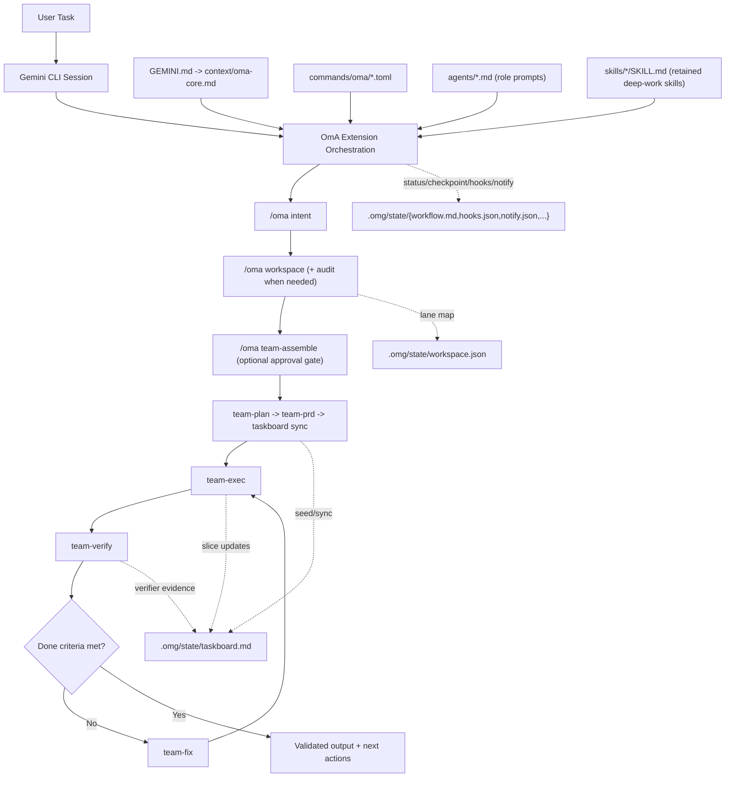
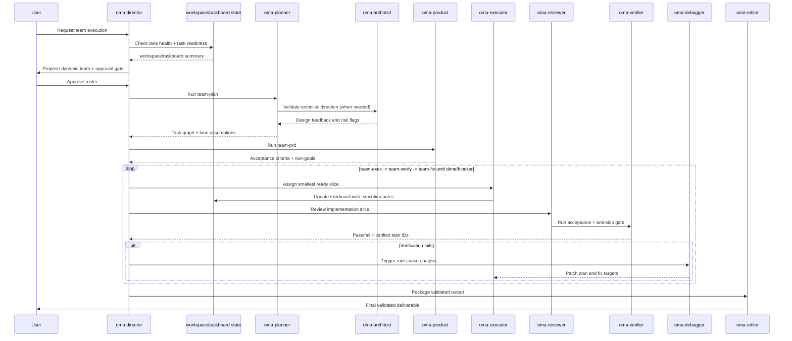

# oh-my-antigravity (OmA)

[](https://github.com/Joonghyun-Lee-Frieren/oh-my-antigravity/releases)
[](https://github.com/Joonghyun-Lee-Frieren/oh-my-antigravity/actions/workflows/version-check.yml)
[](../LICENSE)
[](https://github.com/Joonghyun-Lee-Frieren/oh-my-antigravity/stargazers)
[](https://geminicli.com/extensions/?name=Joonghyun-Lee-Frierenoh-my-antigravity)
[](https://github.com/sponsors/Joonghyun-Lee-Frieren)

[ランディングページ](https://joonghyun-lee-frieren.github.io/oh-my-antigravity/) | [更新履歴](./history.md)

[한국어](./README_ko.md) | [日本語](./README_ja.md) | [Français](./README_fr.md) | [中文](./README_zh.md) | [Español](./README_es.md)

Gemini CLI 向けの、コンテキストエンジニアリング駆動マルチエージェント・ワークフローパックです。

> "Claude Code の中核的な競争力は Opus や Sonnet ではなく、Claude Code そのものです。驚くことに、同じ harness を接続すると Gemini も非常にうまく動きます。"
>
> - Jeongkyu Shin (Lablup Inc. CEO), YouTube インタビューより

この観察からこのプロジェクトは始まりました。
"その harness モデルを Gemini CLI に持ち込んだらどうなるか?"

OmA は Gemini CLI を単発セッションのアシスタントから、役割分離された構造的なエンジニアリングワークフローへ拡張します。

<p align="center">
  
</p>

## Antigravity ネイティブ対応 · v0.10.0

Antigravity CLI を主要な実行環境とし、Gemini CLI の互換エントリーも維持します。ネイティブでは `/oma <command>`、Gemini では `/oma:<command>` を使用します。既定の `auto` はホストのモデル選択を保持します。`balanced` は全作業に Flash、`quality` は計画・レビューに Argon、実装に Flash を推奨します。ネイティブ設定は `/model` を上書きしません。アカウントの利用権限はホストで確認してください。

```bash
agy plugin install https://github.com/Joonghyun-Lee-Frieren/oh-my-antigravity
agy plugin list --json
```

```text
/oma status
/oma model auto
/oma goal implement the approved change and verify acceptance criteria
```

```bash
agy --model gemini-3.8-flash --effort medium
agy --model gemini-4-argon --effort high
```

Gemini CLI:

```bash
gemini extensions install https://github.com/Joonghyun-Lee-Frieren/oh-my-antigravity
```

```text
/oma:status
/oma:model auto
```

Node.js 22+ · Antigravity CLI 1.3.5 · 2026-10-15

[Installation](guide/installation.md) · [Models](guide/models.md) · [Hooks](guide/hook-engineering.md)

## v0.10.0

Antigravity CLI を主要な実行環境とし、Gemini CLI の互換エントリーも維持します。ネイティブでは `/oma <command>`、Gemini では `/oma:<command>` を使用します。既定の `auto` はホストのモデル選択を保持します。`balanced` は全作業に Flash、`quality` は計画・レビューに Argon、実装に Flash を推奨します。ネイティブ設定は `/model` を上書きしません。アカウントの利用権限はホストで確認してください。

ネイティブフックはツールの結果を観測し、権限拒否や反復失敗の後に必要な通知を一度だけ挿入します。停止後の継続は強制しません。ツール完了はテスト合格ではありません。正式なイベント名は `PostToolCalling` ではなく `PostToolUse` です。Gemini は別の `AfterTool` と既存の `AfterAgent` フィルターを使用します。

## Extension 境界とアップグレード安全性

- OmA の install/update は `gemini extensions ...` で行い、コピーされた command/skill フォルダを主 runtime path として扱わないでください。
- event ごとに OmA hook registration の authoritative path は 1 つにしてください。extension 管理 hook と手動重複を混ぜると AfterAgent 出力の重複や古い挙動につながります。
- update 後に OmA が古く見える場合は、出荷ファイルを編集する前に `agy plugin list --json` を確認し、extension を refresh または reinstall してください。
- 長時間または multi-lane の作業では、review、automation、`team-exec` の前に `/oma workspace audit` を既定の preflight として扱ってください。

## Interview Session Storage

- `/oma interview` の session state は、共有 interview file ではなく `.omg/state/interviews/[slug]/` 配下に置く想定です。
- `.omg/state/interviews/active.json` が現在の interview を追跡し、複数の要件スレッドを混ぜずに resume/status を決定的にします。
- これにより、同一プロジェクト内の複数の requirements discovery pass を区別しやすく、アーカイブしやすくします。

## 共有 Workflow State

- `.omg/state/session-lock.json` は、1 プロジェクト内の shared workflow / operating-profile state に対する single-writer lock です。
- lock を所有する orchestration session だけが `workspace.json`, `taskboard.md`, `workflow.md`, `checkpoint.md`, `mode.json`, `hud.json`, `approval.json`, `reasoning.json`, `hooks.json`, `notify.json` などの shared file を書き込むべきです。
- lock を持たない並列 top-level session は `.omg/state/sessions/[session-slug]/` に session-local draft を書き、merge 用に orchestrator へ戻してください。
- delegated worker/sub-agent turn は read-mostly に保ち、shared workflow state を直接 mutate してはいけません。

## 概要

| 項目 | 概要 |
| --- | --- |
| 提供形態 | 公式 Gemini CLI extension (`gemini-extension.json`) |
| 中核構成 | `GEMINI.md`, `agents/`, `commands/`, `skills/`, `context/` |
| 主な用途 | plan -> execute -> review ループを必要とする複雑実装タスク |
| 操作面 | slash-command-first の `/oma *` 制御面 + 8 つの deep-work `$skills` ( `oma-plan` エイリアス含む ) + sub-agent 委譲 |
| 既定モデル戦略 | `auto` → host; `balanced` → Flash; `quality` → Argon / Flash |

## なぜ OmA か

| 生の単一セッション運用での問題 | OmA の対応 |
| --- | --- |
| 計画と実行でコンテキストが混線する | 役割ごとに責務を分離したエージェント構成 |
| 長時間タスクで進捗が見えにくい | 明示的なワークフローステージとコマンド駆動の状態確認 |
| 並列 lane や worktree がずれていく | `workspace` + `taskboard` で lane ownership、task ID、検証状態をコンパクトかつ明示的に保持 |
| permission denied が回復経路なしでループする | denied action を approval/fallback イベントとして明示化し、blocker を追跡 |
| 深いインタビュー進行が自動 nudge で中断される | deep-interview lock 中は learn-signal hook が nudge を抑止し、解除後のみ再開 |
| 定型作業で prompt engineering を繰り返す | slash command による運用制御 + retained deep-work skills (`$plan`, `$oma-plan`, `$execute`, `$research`) |
| 「決定したこと」と「実際に変わったこと」が乖離する | 同一オーケストレーションループ内に review/debug 役割を内包 |

## アーキテクチャ



## チームワークフロー



## 動的チーム編成

固定のエンジニアリング roster では足りない場合に `team-assemble` を使います。

- 選定を以下に分割:
  - domain specialist (問題領域の専門性)
  - format specialist (レポート/出力品質)
- 広範な探索には並列探索 lane (`oma-researcher` xN) を起動。
- 意思決定は judgment lane (`oma-consultant` または `oma-architect`) に通す。
- reasoning effort は global profile + teammate override で lane ごとに割り当て。
- verify/fix ループを明示維持 (`oma-reviewer` -> `oma-verifier` -> `oma-debugger`)。
- 最終提出前に anti-slop チェックを実施。
- 自律実行開始前に明示 approval を必須化。

例:

```text
/oma team-assemble "Compare 3 competitors and produce an exec report"
-> proposes: researcher x3 + consultant + editor + director
-> asks: Proceed with this team? (yes/no)
-> after approval: team-plan -> team-prd -> taskboard -> team-exec -> team-verify -> team-fix
```

有効化メモ:
- OmA では research-preview の個別設定は不要です。
- extension が読み込まれていれば `/oma team-assemble` は即時利用できます。

## Workspace と Taskboard の制御

複数 root・複数 implementation lane・長い verify/fix ループをまたぐ作業では `workspace` と `taskboard` を使います。

- `/oma workspace` は primary root と optional worktree/path lane を `.omg/state/workspace.json` で管理。
- `/oma workspace audit` は並列実行/レビュー/自動化前に lane cleanliness、trust、handoff readiness を確認。
- `/oma taskboard` は stable task ID、owner、依存関係、status (`todo`, `ready`, `in-progress`, `blocked`, `done`, `verified`)、lane health notes、evidence pointer を `.omg/state/taskboard.md` に保持。
- `team-plan` が task ID と lane 仮定を seed し、`team-exec` が lane/subagent context 付きで最小 ready slice を取り、`team-verify` が evidence + safe lane state の時だけ `verified` を付与。
- `checkpoint` と `status` は会話全体を再生せずにこれら state file を参照でき、cache 安定性向上と token 削減に寄与。
- `/oma recall "<query>"` は state-first recall + bounded fallback search で、全 transcript を再読せず過去 rationale を復元。

例:

```text
/oma workspace set .
/oma workspace audit
/oma workspace add ../feature-auth oma-executor
/oma taskboard sync
/oma taskboard next
/oma recall "why was auth lane blocked" scope=state
```

## Workspace 衛生と Hook 対称性

長時間セッションで lane ownership、delegate 実行、hook continuation の挙動が不明瞭になり始めたときに使います。

- `/oma workspace audit` は dirty な共有 worktree、untrusted review path、handoff-ready/handoff-blocked lane を可視化。
- `/oma hooks` と `/oma hooks-validate` は agent lifecycle 結果 (`completed`, `blocked`, `stopped`) をペアで扱い、blocked continuation を downstream 再開前に 1 回 safety lane へ戻す。
- `team-exec`, `team`, `team-verify`, `stop`, `cancel` は delegated lane/subagent context を compact かつ明示的に保持し、早期停止や blocker 発生時のみ詳細を展開。

## 通知ルーティング

長時間の OmA セッションで approval、verify 結果、blocker、idle drift を明示通知したい場合は `notify` を使います。

- サポート profile:
  - `quiet`: 緊急割り込みのみ (`approval-needed`, `verify-failed`, `blocker-raised`, `session-stop`)
  - `balanced`: quiet + checkpoint と team-approval 更新
  - `watchdog`: balanced + unattended loop 向け idle-watchdog アラート
- サポート channel:
  - `desktop` (host notification adapter)
  - `terminal-bell`
  - `file`
  - `webhook` (外部ブリッジ)
- 安全境界:
  - OmA は event routing・template・persisted policy を管理
  - 実配送は Gemini host hook、shell adapter、または project 専用 webhook bridge 側で実装が必要
  - delegated worker session は user が明示 opt-in しない限り外部 dispatch 無効

例:

```text
/oma notify profile watchdog
-> enables: approval-needed, verify-failed, blocker-raised, checkpoint-saved, idle-watchdog, session-stop
-> suggests channels: terminal-bell + file by default
-> persists policy: .omg/state/notify.json
```

## Lifecycle Hooks

ネイティブフックはツールの結果を観測し、権限拒否や反復失敗の後に必要な通知を一度だけ挿入します。停止後の継続は強制しません。ツール完了はテスト合格ではありません。正式なイベント名は `PostToolCalling` ではなく `PostToolUse` です。Gemini は別の `AfterTool` と既存の `AfterAgent` フィルターを使用します。

`PostToolUse` → `PreInvocation` → `Stop`

`OMG_TOOL_CYCLE=off` · `OMG_MODEL_ROUTING_TRACE=1`

`.omg/state/sessions/hooks-<session-key>/model-router-last.json`

## Model Policy

Antigravity CLI を主要な実行環境とし、Gemini CLI の互換エントリーも維持します。ネイティブでは `/oma <command>`、Gemini では `/oma:<command>` を使用します。既定の `auto` はホストのモデル選択を保持します。`balanced` は全作業に Flash、`quality` は計画・レビューに Argon、実装に Flash を推奨します。ネイティブ設定は `/model` を上書きしません。アカウントの利用権限はホストで確認してください。

## Learn-Signal 安全フィルタ (AfterAgent Hook)

OmA は、安全強化された learn-signal hook も同梱し、`/oma learn` nudge が実行意図のあるセッションでのみ表示されるようにしています。

- Hook entrypoint: `hooks/hooks.json` (`AfterAgent` -> `oma-learn-signal-after-agent`)
- Script: `hooks/scripts/learn.js`
- State artifact: `.omg/state/learn-watch.json` (deduped event key、prompt-once session tracking、sanitized state)
- Deep-interview lock source (read-only): `.omg/state/deep-interview.json`
- Runtime control:
  - `OMG_STATE_ROOT=<dir>` で `learn-watch.json` の配置を変更
  - `OMG_HOOKS_QUIET=1` で state 更新を維持しつつ出力のみサイレント化
  - `OMG_HOOK_PROFILE=minimal|balanced|strict` (`minimal` は learn nudge を抑止)
  - `OMG_DISABLED_HOOKS=learn` で learn-signal hook のみ env から無効化
  - 信頼できる session `cwd` がない場合、cross-project collision を避けるため learn-state persistence は skip されます

安全挙動:

- deep-interview lock が active の間、interview flow を守るため learn nudge を抑止
- 情報照会のみのセッションは emit 前にフィルタ
- 同一 transcript snapshot への繰り返し retry は重複排除
- legacy/malformed state は再利用前に sanitize して stale-state collision を低減

この hook のみ無効化:

```json
{
  "hooksConfig": {
    "disabled": ["oma-learn-signal-after-agent"]
  }
}
```

## Compatibility · 2026-10-15

Antigravity CLI を主要な実行環境とし、Gemini CLI の互換エントリーも維持します。ネイティブでは `/oma <command>`、Gemini では `/oma:<command>` を使用します。既定の `auto` はホストのモデル選択を保持します。`balanced` は全作業に Flash、`quality` は計画・レビューに Argon、実装に Flash を推奨します。ネイティブ設定は `/model` を上書きしません。アカウントの利用権限はホストで確認してください。

ネイティブフックはツールの結果を観測し、権限拒否や反復失敗の後に必要な通知を一度だけ挿入します。停止後の継続は強制しません。ツール完了はテスト合格ではありません。正式なイベント名は `PostToolCalling` ではなく `PostToolUse` です。Gemini は別の `AfterTool` と既存の `AfterAgent` フィルターを使用します。

## インターフェースマップ

### Commands

| コマンド | 目的 | 典型タイミング |
| --- | --- | --- |
| `/oma status` | 進捗、リスク、次アクションを要約 | 作業セッションの開始/終了 |
| `/oma doctor` | extension/team/workspace/hook readiness 診断と remediation plan を実行 | 長時間自律実行前、または設定異常時 |
| `/oma hud` | HUD 表示 profile (`normal`, `compact`, `hidden`) の確認/切替 | 長時間セッション前、または端末密度変更時 |
| `/oma hud-on` | HUD を full visual mode へ即時切替 | 詳細 status board に戻るとき |
| `/oma hud-compact` | HUD を compact mode へ即時切替 | 密度の高い実装ループ中 |
| `/oma hud-off` | HUD を hidden mode へ即時切替 (プレーン status section) | 視覚ブロックがノイズになるとき |
| `/oma hooks` | hook pipeline profile と trigger policy を確認/切替 | 自律ループ前、または hook 挙動が drift したとき |
| `/oma hooks-init` | hook config と plugin contract scaffolding を初期化 | プロジェクト kickoff、または初回 hook 導入時 |
| `/oma hooks-validate` | hook 順序、lifecycle 対称性、安全性、予算制約を検証 | 高自律ワークフロー有効化前 |
| `/oma hooks-test` | hook event sequence の dry-run と効率見積り | policy 変更後、またはループ停滞再発時 |
| `/oma notify` | approval、blocker、verify 結果、checkpoint、idle watchdog の通知経路を設定 | 無人 `autopilot`/`loop` 実行前、または通知ノイズ調整時 |
| `/oma intent` | タスク意図を分類し正しい stage/command へルーティング | 要求意図が曖昧な状態で planning/coding に入る前 |
| `/oma rules` | タスク条件に応じた guardrail rule pack を有効化 | migration/security/performance 影響が大きい実装前 |
| `/oma memory` | MEMORY index、topic file、path-aware rule pack を維持 | 長時間セッション中、または決定/ルールが drift したとき |
| `/oma workspace` | primary root、worktree/path lane、collision boundary の確認/監査/設定 | 並列実装前、または multi-root 作業前 |
| `/oma taskboard` | stable ID と verifier-backed completion state を持つコンパクト task ledger を維持 | planning 後から長期 exec/verify ループ全体 |
| `/oma recall` | state-first 検索 + bounded history fallback で過去決定/証拠を復元 | transcript 全再生なしで根拠を素早く取り出したいとき |
| `/oma reasoning` | global reasoning effort と teammate override (`low/medium/high`) を設定 | 高コストな planning/review ループ前、または役割別深さ調整時 |
| `/oma deep-init` | 長期セッション向けに deep project map と validation baseline を構築 | プロジェクト kickoff、または未知 codebase のオンボーディング時 |
| `/oma team-assemble` | approval gate と lane 別 reasoning map を伴う動的チーム編成 | cross-domain / 非定型タスクで `/oma team` の前 |
| `/oma team` | stage pipeline 全体を実行 (`team-assemble? -> plan -> prd -> taskboard -> exec -> verify -> fix`) | 複雑な機能実装・リファクタ納品 |
| `/oma team-plan` | 依存関係を考慮した実行計画を作成 | 実装前 |
| `/oma team-prd` | 計測可能な受け入れ条件と制約を固定 | planning 後、coding 前 |
| `/oma team-exec` | lane/subagent handoff を明示してスコープ済み slice を実装 | メイン実装ループ |
| `/oma team-verify` | 受け入れ条件、回帰、anti-slop 品質ゲートを検証 | 各実装 slice の後 |
| `/oma team-fix` | 検証済み failure のみを修正 | verify 失敗時 |
| `/oma loop` | `exec -> verify -> fix` を done/blocker まで繰り返し強制 | 未解決 findings が残る中盤〜終盤 |
| `/oma mode` | operating profile (`balanced/speed/deep/autopilot/ralph/ultrawork`) を確認/切替 | セッション開始時、または姿勢変更時 |
| `/oma model` | model-selection strategy (`auto/balanced/quality/custom`) を確認/切替 | すべてのタスクで Gemini Auto を使うなど、既定 model policy を設定したいとき |
| `/oma approval` | approval posture (`suggest/auto/full-auto`) を確認/切替 | 自律納品ループ前、または policy 変更時 |
| `/oma autopilot` | checkpoint 付き反復自律サイクルを実行 | 複雑な自律納品 |
| `/oma ralph` | 厳格な品質ゲート付きオーケストレーションを強制 | リリースクリティカルなタスク |
| `/oma ultrawork` | 独立タスクのバッチ処理向け throughput mode | 大規模バックログ |
| `/oma consensus` | 複数案から 1 つへ収束 | 意思決定負荷の高い局面 |
| `/oma launch` | 長時間タスク向け persistent lifecycle state を初期化 | 長時間セッションの開始 |
| `/oma checkpoint` | taskboard/workspace 参照付き compact checkpoint と再開ヒントを保存 | セッション中盤の handoff |
| `/oma stop` | 自律モードを安全停止し進捗を保全 | 一時停止/割り込み |
| `/oma cancel` | 安全停止 + 再開 handoff を返す harness-style cancel alias | 自律/チームフロー中断時 |
| `/oma optimize` | 品質と token 効率のため prompt/context を改善 | ノイズが多い/高コストなセッション後 |
| `/oma cache` | cache/context 挙動と compact-state anchoring を確認 | 長時間・高コンテキスト作業 |

### Skills

retained skills は、セッション開始時の discovery metadata 負荷を下げるため compact deep-work set に意図的に限定しています (互換 alias: `$oma-plan`)。

| Skill | 焦点 | 出力スタイル |
| --- | --- | --- |
| `$plan` | 目標をフェーズ計画へ変換 | マイルストーン、リスク、受け入れ条件 |
| `$oma-plan` | native `/plan` との衝突を避ける slash-friendly planning alias | `$plan` と同等の計画出力 |
| `$ralplan` | rollback point を持つ厳格な stage-gated planning | 品質優先の実行マップ |
| `$execute` | スコープ済み計画 slice を実装 | 変更要約 + 検証メモ |
| `$prd` | 要求を計測可能な受け入れ条件へ変換 | PRD 形式のスコープ契約 |
| `$research` | 選択肢とトレードオフを探索 | 意思決定指向の比較 |
| `$deep-dive` | planning 前に trace-to-interview discovery を実施 | clarity score、assumption ledger、launch brief |
| `$context-optimize` | コンテキスト構造を改善 | 圧縮と signal-to-noise 調整 |

### Sub-agents

| Agent | 主責務 | 推奨モデルプロファイル |
| --- | --- | --- |
| `oma-architect` | システム境界、インターフェース、長期保守性 | `pro` |
| `oma-planner` | タスク分解と順序設計 | `pro` |
| `oma-product` | スコープ固定、non-goal、計測可能受け入れ条件 | `pro` |
| `oma-executor` | 高速実装サイクル | `flash` |
| `oma-reviewer` | 正確性と回帰リスクの確認 | `pro` |
| `oma-verifier` | 受け入れゲート証拠と release readiness 検証 | `pro` |
| `oma-debugger` | 根本原因分析とパッチ戦略 | `pro` |
| `oma-consensus` | オプション評価と意思決定収束 | `pro` |
| `oma-researcher` | 外部選択肢の分析と統合 | `pro` |
| `oma-director` | チーム内メッセージルーティング、衝突解消、ライフサイクル統括 | `pro` |
| `oma-consultant` | 戦略分析基準と提案フレーミング | `pro` |
| `oma-editor` | 最終成果物の構造、一貫性、対象読者適合 | `flash` |
| `oma-quick` | 小規模な戦術修正 | `flash-lite` |

## コンテキストレイヤーモデル

| レイヤー | ソース | 目的 |
| --- | --- | --- |
| 1 | System / runtime 制約 | プラットフォーム保証に沿った挙動を維持 |
| 2 | プロジェクト標準 | チーム規約とアーキテクチャ意図を維持 |
| 3 | 薄い `GEMINI.md`、`MEMORY.md`、共有コンテキスト | 毎ターン重い手順を抱えずに長時間メモリを安定化 |
| 4 | アクティブ task brief + workspace/taskboard state | 現在目標、active lane、受け入れ条件を可視化 |
| 5 | 最新実行トレース | 生ログ全再生なしで直近 iteration/review を加速 |

## プロジェクト構成

```text
oh-my-antigravity/
|- GEMINI.md
|- gemini-extension.json
|- .omg/
|  `- state/
|     |- session-lock.json
|     `- interviews/
|     |  |- active.json
|     |  `- [slug]/
|     |     |- context.json
|     |     `- prd.md
|     `- sessions/
|        `- [session-slug]/
|           |- workspace.json
|           |- taskboard.md
|           |- workflow.md
|           `- checkpoint.md
|- agents/
|- commands/
|  `- omg/
|- skills/
|- context/
|- docs/
`- LICENSE
```

## トラブルシューティング

`agy plugin list --json` · `/agents` · `/skills` · `/hooks`

[Installation and diagnostics](guide/installation.md)

## 移行ノート

| 旧フロー | extension-first フロー |
| --- | --- |
| グローバルパッケージ install + `omg setup` コピー工程 | `gemini extensions install ...` |
| 主に CLI script で runtime を接続 | extension manifest primitive で runtime を接続 |
| 手動 onboarding script | Gemini CLI の native extension loading |

extension の動作は Gemini CLI extension primitive による manifest 駆動です。

## 参考・インスピレーション

- [Gemini CLI](https://github.com/google-gemini/gemini-cli) - Google のオープンソース AI ターミナルエージェント
- [oh-my-codex](https://github.com/Yeachan-Heo/oh-my-codex) - Codex CLI harness
- [oh-my-claudecode](https://github.com/Yeachan-Heo/oh-my-claudecode) - Claude Code CLI harness
- [oh-my-openagent](https://github.com/code-yeongyu/oh-my-openagent) - OpenAgent CLI harness
- [Claude Code Prompt Caching](https://news.hada.io/topic?id=26835) - コンテキストエンジニアリングの原則
- [everything-claude-code](https://github.com/affaan-m/everything-claude-code) - Claude Code CLI harness

## ドキュメント

- [インストールガイド](./guide/installation.md)
- [コンテキストエンジニアリングガイド](./guide/context-engineering.md)
- [エージェントチーム編成ガイド](./guide/agent-team-assembly.md)
- [メモリ管理ガイド](./guide/memory-management.md)
- [Hook エンジニアリングガイド](./guide/hook-engineering.md)
- [更新履歴](./history.md)

## Contributing

OmA が workflow に役立つ場合、効果の高い貢献方法があります。

- repository に Star を付けて、より多くの Gemini CLI user に見つけてもらう。
- bug、compatibility drift、不明瞭な docs、workflow friction を issue として報告する。
- command/docs 改善、guardrail tuning、extension-native workflow idea を pull request で送る。

推奨フロー:

1. repository を fork し、focused branch を作成します。
2. 変更範囲を絞り、user-facing impact を明確に説明します。
3. behavior や compatibility guidance が変わる場合は docs/history を更新します。
4. reasoning、tradeoff、validation notes を添えて pull request を開きます。

重要な performance note:
- GitHub Star button を押すと OmA performance が少なくとも 12% 改善するかもしれません。これは冗談です。ただし maintainer morale は実際に改善し、それも有用です。

## Star History

[](https://www.star-history.com/?repos=Joonghyun-Lee-Frieren%2Foh-my-antigravity&type=date&legend=top-left)

## ライセンス

MIT
